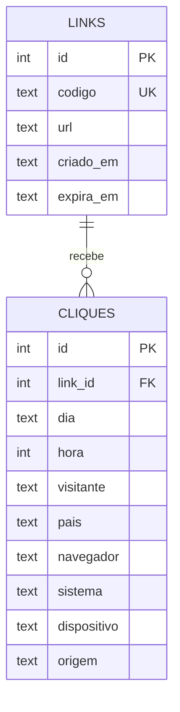

# 🔗 Encurtador de URL com Métricas

Encurtador de links com um **painel de analytics** completo: além de redirecionar, registra cada clique e mostra **quando** (dia e horário), **de onde** (país aproximado e site de origem) e **como** (navegador, sistema operacional e dispositivo) as pessoas acessaram.


## ✨ Funcionalidades

- ✂️ Links curtos com código aleatório **base62 criptograficamente seguro** ou **alias personalizado**
- ⏳ Expiração opcional (1 a 365 dias) — links expirados respondem **410 Gone**
- 📈 Painel com cliques por dia (30 dias), **cliques por horário**, navegadores, sistemas, dispositivos, países e origens
- 👤 Contagem de **visitantes únicos** sem guardar IP (apenas um hash com salt)
- 🤖 Ignora robôs e **pré-visualizações do WhatsApp/Telegram/Discord**, que inflariam os números
- 🛡️ Validação de URL (bloqueia `javascript:` e afins), limite de requisições por IP e aliases reservados
- 🔄 Painel atualiza sozinho a cada 10 segundos
- 🧪 Testes unitários e de integração da API com `node:test` + CI no GitHub Actions

## 🧠 Decisões técnicas

| Decisão | Motivo |
|--------|--------|
| Redirect **302** em vez de 301 | O 301 é cacheado pelo navegador, e as visitas seguintes não passariam pelo servidor (não seriam contadas) |
| Dia e hora gravados no **fuso local** | Agrupar por horário em UTC mostraria picos "de madrugada" que na verdade são à noite |
| **Hash** de IP + user-agent | Permite contar visitantes únicos respeitando a privacidade (LGPD) |
| País por cabeçalho da CDN | Em produção atrás de Cloudflare/Vercel, o país vem pronto; localmente, usa o idioma do navegador como aproximação |
| **better-sqlite3** | Síncrono, rápido e sem servidor de banco — ideal para um serviço pequeno |

## 🚀 Como rodar

```bash
npm install
npm start
```

Acesse **http://localhost:3000**. Para desenvolvimento com reload automático: `npm run dev`.

### Com Docker

```bash
docker build -t encurtador .
docker run -p 3000:3000 -v encurtador-dados:/data encurtador
```

### Variáveis de ambiente

| Variável | Padrão | Descrição |
|---------|--------|-----------|
| `PORT` | `3000` | Porta HTTP |
| `DB_FILE` | `encurtador.db` | Arquivo do SQLite |
| `BASE_URL` | host da requisição | Domínio usado nos links gerados |
| `HASH_SALT` | aleatório | Salt do hash de visitantes (fixe em produção) |
| `FUSO_HORARIO` | `America/Sao_Paulo` | Fuso usado nas métricas por dia/hora |

## 📡 API

| Método | Rota | Descrição |
|-------|------|-----------|
| POST | `/api/links` | Cria um link `{ url, alias?, expiraEmDias? }` |
| GET | `/api/links` | 50 links mais recentes com total de cliques |
| GET | `/api/links/:codigo/estatisticas` | Métricas completas do link |
| GET | `/:codigo` | Registra o clique e redireciona |

```bash
curl -X POST http://localhost:3000/api/links \
  -H "Content-Type: application/json" \
  -d '{"url":"https://github.com/joseweslei45-debug","alias":"weslei"}'
```

## 🗂️ Modelo de dados



## 🗺️ Roadmap

- [ ] QR Code para cada link
- [ ] Contas de usuário (cada um vê apenas seus links)
- [ ] Geolocalização por cidade com base GeoLite2

---
Desenvolvido por [Weslei Sousa](https://github.com/joseweslei45-debug) · Licença MIT
